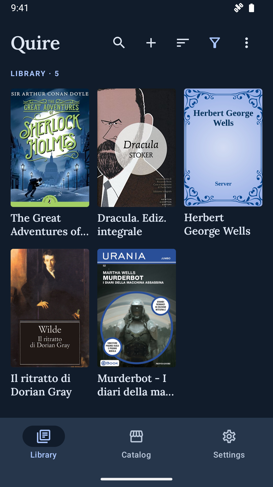
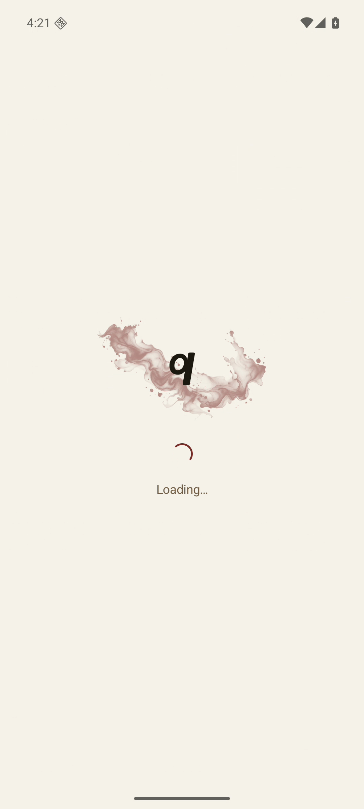
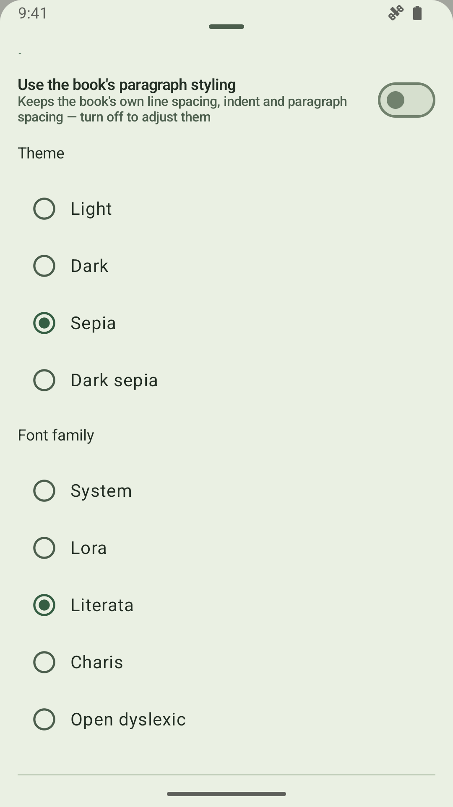

<p align="center">
  
</p>

<h1 align="center">Quire</h1>

<p align="center">
  <strong>Lose yourself. Keep your place.</strong>
</p>

<p align="center">
  An Android EPUB reader for the library you keep.<br>
  Import your books, browse OPDS catalogs, and sync your place through a server you own.<br>
  No telemetry. Optional AI, off by default.
</p>

<p align="center">
  <a href="https://github.com/vitofico/quire/actions/workflows/android-ci.yaml"></a>
  <a href="https://github.com/vitofico/quire/actions/workflows/server-ci.yaml"></a>
  <a href="LICENSE"></a>
  <a href="server/LICENSE"></a>
</p>

<p align="center">
  <a href="#install">Install</a> ·
  <a href="#bring-your-books">Bring your books</a> ·
  <a href="server/README.md">Set up a server</a> ·
  <a href="#privacy">Privacy</a>
</p>

<p align="center">
  <a href="docs/assets/readme-library-sage.webp"></a>
  &nbsp;&nbsp;
  <a href="docs/assets/readme-library-midnight.webp"></a>
  &nbsp;&nbsp;
  <a href="docs/assets/readme-reader.png"></a>
</p>

<p align="center"><em>Your shelf, your palette, your reading page. Open a screenshot for the full-resolution view.</em></p>

The library and reader examples use actual EPUBs retrieved read-only from a CWA
library and imported on a disposable emulator. No book files, server address or
credentials are included. See the [screenshot notes](docs/assets/README.md).

## Made for reading

- **Read offline.** Import EPUBs from your device or download them from an
  OPDS catalog, then keep reading without a connection.
- **Make the page comfortable.** Adjust the typeface, text size, line spacing
  and page theme. The reader's bars and menus take the page's colours.
- **Keep passages.** Enter Highlight mode to save coloured passages, change
  their colour or remove them. Open **More → Highlights** to browse the book's saved passages
  and return to their exact pages. From a text selection, Copy as quote includes
  the book title and author. [Highlights work offline and sync with Quire Server](docs/reader-highlights.md),
  including when you remove a download and later import the same book again.
  Quire Server also offers [read-only Agent/MCP access](docs/agent-access.md) to
  authorized stored highlights; device-local memory bookmarks are never exposed.
- **Leave yourself a way back.** Open **More → Pause & resume** in the reader
  to save a memory bookmark with an optional sentence or question and nearby
  passage context. Return explicitly, edit the note, replace its location or
  remove it. It stays on this device, scoped to the book and account/catalog;
  local-only reading has its own scope. Removing the download removes this
  bookmark, while highlights remain separate.
- **Find a place to stop.** The same sheet shows the approximate percentage of
  the whole book ahead to the next mapped section, chapter/resource or book end.
  It is a coarse distance, never a minutes or reading-pace estimate; insufficient
  publication structure produces an unavailable message. See
  [Pause and return](docs/reader-pause.md) for the boundaries and controls.
- **Keep a useful shelf.** Search, sort, continue reading, and filter finished
  or abandoned books. With Quire Server, Library Stats brings together reading
  counts and authors.
- **Know what is in a book.** Tap its info icon or long-press it for the
  description, series, publisher, language, subjects, ISBN, progress and file size.
  Imported EPUB metadata stays with the book.

Under **Settings → Appearance**, follow the system or stay light or dark.
Choose Paper or Sage for light mode, and Ink or Midnight for dark mode.
Choose **Artwork** for the ink background or **Plain** for solid surfaces,
independently of the palette. These choices are saved for your next launch.
App palettes are separate from the page theme inside a book: tap the page and
open **Aa** to adjust the font, spacing, margins and page colours.

<details>
<summary>See the reader, marbled loading and both library palettes</summary>

The same ink appears during real loading work, without an added waiting period.
The new library screenshots show five imported books. The reader shows an
actual Sherlock Holmes page in Sepia and Literata. Open a full-size example:
[Sage library](docs/assets/readme-library-sage.webp),
[Midnight library](docs/assets/readme-library-midnight.webp),
[Reader page](docs/assets/readme-reader.png),
[Paper loading](docs/assets/identity-refinement/loading-paper.png), or
[Ink loading](docs/assets/identity-refinement/loading-ink.png).

<p align="center">
  
  &nbsp;
  <picture>
    <source media="(prefers-color-scheme: dark)" srcset="docs/assets/identity-refinement/loading-ink.png">
    
  </picture>
  &nbsp;
  <a href="docs/assets/readme-reader-preferences.png"></a>
</p>

</details>

## Bring your books

- **On this device:** import EPUB files and keep your reading place locally.
  No server is required.
- **From an OPDS catalog:** browse, search and download from an OPDS 1.x feed,
  including [calibre-web] and [Kavita]. Give Quire the full catalog feed URL for
  a generic OPDS connection. This mode keeps reading state on the device;
  server sync, the library mirror and AI features stay off.
- **Across devices:** add a compatible **Quire Server** to sync reading state
  and your per-user library mirror. The calibre-web integration keeps
  calibre-web as the source of books and Quire Server as the source of reading
  state. Onboarding supports calibre-web credentials and compatible Quire
  Server account sign-in, according to the server you run.

On first launch, **Skip — use offline only** opens the local library. Tap **+**
to import an EPUB with Android's file picker; opening an EPUB shared by another
app also imports it. **Connect to my server** sets up remote browsing and
compatible server sign-in. If your Quire sync server has a separate address,
enter its optional URL in Settings.

Quire is the native Kotlin / Compose / Readium client. Quire Server is an
optional FastAPI service backed by Postgres, available as
`ghcr.io/vitofico/quire-server`. The [server guide](server/README.md) covers
self-hosting; the [architecture](docs/architecture.md) covers how the parts fit.

## AI, on your terms

AI is **off by default** and each user **opts in**. A server administrator
chooses an OpenAI-compatible endpoint: a local model through Ollama,
llama.cpp or vLLM, or a provider such as OpenAI or OpenRouter. Choosing a
provider means requests go to that provider; self-hosting Quire Server does
not make a remote model local.

With AI enabled and opted into, Quire can provide:

- **Book and catalog insights:** author context, series placement, themes,
  craft notes, comparisons, discussion prompts and content advisories, with
  citations from Wikipedia and OpenLibrary. Preview a catalog book before
  downloading it; cached insights carry over to the owned book.
- **A reader profile:** an on-demand narrative based on finished books, with
  suggestions from your library, OpenLibrary discovery and the model.
- **Your preferred voice:** adjustable tone and language, plus regeneration
  with feedback. Shared instance caches avoid repeating the same generation.

ISBN scanning also looks up a physical book through OpenLibrary. A compatible
Quire Server can return an already-owned check and a deterministic reader-affinity
score based on your library, **without an LLM call**. A generated insight is
an optional follow-up. ISBN metadata and cover lookups are separate from AI opt-in.

Administrators can set per-user budgets and run sync-only, AI-only or full
server deployments. See [AI configuration](docs/configuration.md) and the
[server guide](server/README.md) for the supported setup and privacy boundaries.

## Privacy

**No telemetry, analytics or crash reporting.**

- Catalog and sync requests go to your configured catalog and Quire Server.
  Book downloads and covers can use the hosts linked by an OPDS feed.
- When you scan or enter an ISBN, the Android app contacts **OpenLibrary** for
  metadata and may fetch its cover from `covers.openlibrary.org`. These lookups
  can happen without AI opt-in.
- When AI is enabled and you opt in, Quire Server contacts the configured
  model endpoint and the public Wikipedia and OpenLibrary APIs for grounding
  and discovery. The endpoint may be local or a third-party provider chosen
  by your administrator.
- Memory bookmarks and their notes stay in the device database, separate from
  reading-progress and highlight sync. They make no AI calls or book uploads.
- Stored credentials are encrypted with keys protected by **Android Keystore**,
  hardware-backed where the device supports it.

## Install

Quire runs on **Android 8.0 or newer**. Get it from [F-Droid], add the
[GitHub repository to Obtainium][Obtainium-add], or download an APK from
[Releases]. Obtainium follows GitHub Releases; F-Droid publishes on its own
schedule and may offer an earlier version. Its published developer-signed
releases are [verified against the source][F-Droid].

<a href="https://f-droid.org/packages/io.theficos.quire/">
  
</a>
<a href="https://apps.obtainium.imranr.dev/redirect?r=obtainium://add/https://github.com/vitofico/quire">
  
</a>

On first launch, connect a server or catalog, or continue with local EPUBs.
For historical Play Protect installation reports, see
[#108](https://github.com/vitofico/quire/issues/108).

To sync across devices, follow [`server/README.md`](server/README.md).
It includes Docker Compose setups for an existing reverse proxy or a full
Caddy-fronted stack with calibre-web, Quire Server and TLS. Ready-to-use
configuration examples live in [`docs/configuration.md`](docs/configuration.md).

## Why Quire

Quire started with a simple need: read an OPDS library on Android and sync
reading progress to a server under the reader's control. The app works on its
own; the companion server adds shared reading state and optional insights.

A *quire* /ˈkwaɪər/ is a gathering of folded leaves, bound into a book.

## Build from source

```sh
# Build the debug APK using the project's Docker-based Gradle wrapper.
# Host JDK and Android SDK are not required.
scripts/dgradle :app:assembleDebug
# APK at app/build/outputs/apk/debug/app-debug.apk
```

Sync server development:

```sh
cd server
uv venv && source .venv/bin/activate
uv pip install -e ".[dev]"
uv run pytest                                  # spins up Postgres in Docker
QUIRE_SERVER_CWA_BASE_URL=https://library.example.com \
  uv run uvicorn quire_server.main:app --reload   # http://localhost:8000
```

## Repo layout

```
app/                  Android entry point — Compose UI, navigation, DI wiring
auth/                 Encrypted credentials for catalog and server accounts
core/identity/        Document identity: hash + dc:identifier normalization
core/model/           Domain types (Document, Progress, Bookmark)
data/local/           Room database, DAOs
data/opds/            calibre-web OPDS client
data/sync/            quire-server REST client + WorkManager job
data/library/         quire-server /library/v1 HTTP client (stats today)
reader/               Readium navigator integration
server/               quire-server (Python / FastAPI)
docs/                 Architecture, development, sync API reference
scripts/dgradle       Gradle wrapper that runs inside the project's Docker image
Dockerfile            Reproducible Android build environment (linux/amd64)
```

## Documentation

- [`docs/architecture.md`](docs/architecture.md) — components, document
  identity, sync model, conflict resolution, auth.
- [`docs/development.md`](docs/development.md) — module layout, build
  commands, testing, CI, releases.
- [`docs/sync-api.md`](docs/sync-api.md) — REST surface of Quire Server.
- [Reader highlights](docs/reader-highlights.md) and
  [Pause and return](docs/reader-pause.md) — separate saved-passage workflows.
- [Agent access](docs/agent-access.md) — read-only highlight REST/MCP setup.

## Make Quire speak your language

English is the default; Spanish, Italian, French and German are included.
Translations are complete Android resource folders, with automatic language
discovery and completeness checks. Adding a language needs only XML files.
The [translation guide](docs/translating.md) covers corrections, the
`scripts/new-translation` helper and the shared glossary. Native speakers are
welcome to contribute and review the wording.

## Contributing

See [`CONTRIBUTING.md`](CONTRIBUTING.md). TL;DR: gitmoji + conventional
commits, `scripts/dgradle test` and `cd server && uv run pytest` must
pass, no telemetry / analytics PRs. External contributors also need to
sign the [Quire CLA](CLA.md) on the PR before it can be merged — see
CONTRIBUTING.md for the one-line comment.

## Security

If you find a vulnerability, please follow [`SECURITY.md`](SECURITY.md)
rather than opening a public issue.

## License

The Android app is licensed under Apache-2.0: see [`LICENSE`](LICENSE) and
[`NOTICE`](NOTICE). Quire Server, everything under [`server/`](server/), is
licensed under AGPL-3.0-only: see [`server/LICENSE`](server/LICENSE). Server
code published before 2026-10-20 remains available under Apache-2.0, the
license it was released with. Contributions are accepted under the
[contributor agreement](CLA.md).

## Support

If Quire is useful to you and you'd like to chip in, you can buy me a coffee:

[](https://ko-fi.com/vito507767)

[calibre-web]: https://github.com/janeczku/calibre-web
[Releases]: https://github.com/vitofico/quire/releases
[F-Droid]: https://f-droid.org/packages/io.theficos.quire/
[Obtainium-add]: https://apps.obtainium.imranr.dev/redirect?r=obtainium://add/https://github.com/vitofico/quire
[Kavita]: https://www.kavitareader.com/
