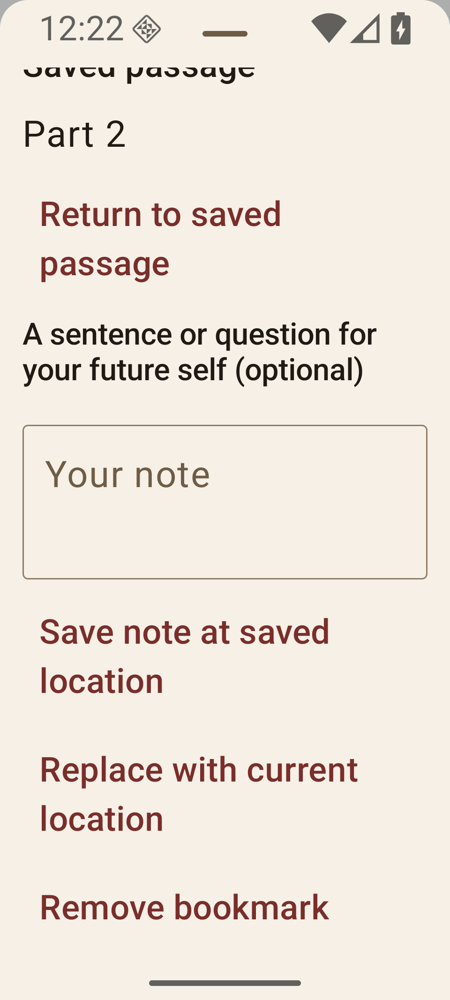

# Reader pause and return

The reader’s **More → Pause & resume** action opens the pause sheet. Its filled
bookmark icon in the menu means a memory bookmark exists. This is a deliberate action: opening a book or rotating never
opens the sheet automatically. The scrollable sheet opens fully expanded so its
actions remain reachable on narrow screens and with large text.

A reader can save an optional sentence or question at the current location. The
bookmark retains the full Readium locator, plus up to 1,500 characters of nearby
passage text when the navigator supplies it. A DOM page-start anchor is requested
at save time when possible; otherwise the current locator is retained. Notes are
limited to 2,000 characters. Returning uses the same explicit-jump path as other
reader navigation, which clears any pending resize anchor. Updating a note keeps
its saved location; **Replace with current location** deliberately moves it.

This first version keeps one memory bookmark per downloaded book and account in
the local Room database, separate from progress and its sync status. It never
calls AI, uploads EPUB content, or synchronizes bookmarks. Account namespaces
hash the catalog/server URL and stable subject; changing a password/token does
not change the namespace. Signed-out local reading has a separate namespace.
Changing account while the reader is open clears its visible bookmark and blocks
operations until the book is reopened. Removing a book cascades all its local
bookmark rows, including those saved under another account. Signing out alone
does not delete them. Existing Android database backup rules still apply.

Malformed or unavailable saved locations are retained along with their notes;
return/edit-at-saved-location is disabled and recovery guidance offers copying
the note, explicit replacement at the live location, or removal. A failed save
does not silently overwrite the original note.

## Good stopping point

The same sheet shows the approximate share of the whole book remaining to the
next mapped break, rounded up to a whole percent. This is a distance estimate,
not a duration or screen-page count. It uses the current publication position
and the ordered Readium position list. No reading pace, wall-clock observation,
AI inference, or title spoilers are involved.

Nested TOC links are traversed. A fragment-level section is counted only if an
available position resolves its fragment. Otherwise the next mapped
chapter/resource boundary is used and labelled honestly. End-of-book distance
is offered only in the final reading-order resource. The last position still
has content remaining unless the locator explicitly reports completion. Missing
or inconsistent positions produce an unavailable message instead of a guess.
Idle time cannot alter the distance; jumps recompute it from their new location.
The distance is necessarily coarse, particularly for tiny resources or missing
TOC anchors. Whole-book percent may be less useful for very long books; this
first version intentionally avoids claiming minutes without a defensible pace.

## Acceptance fixture and steps

`app/src/test/resources/reader-pause.epub` contains original synthetic text, three
resources, a nested TOC entry and stable paragraph markers. Regenerate it with:

```sh
python3 scripts/make-reader-pause-fixture.py app/src/test/resources/reader-pause.epub
```

1. Import the fixture and open it. Reveal controls, open **More → Pause & resume**, and
   inspect the labelled stopping distance. Its nested TOC fragment may be
   unavailable in Readium’s generated positions; the next resource fallback is
   expected in that case.
2. At a marker in the middle of part one, save “Why is the narrator avoiding
   this?” Verify the saved passage and filled bookmark icon in More. Close/reopen the
   sheet, move several pages, and use **Return to saved passage**. Check the saved
   marker, question and passage. Save an empty note too: a location alone is valid.
3. Force-stop and relaunch the app offline. Reopen the book and deliberately open
   the sheet. The saved question and passage must remain and return must work.
4. Edit the question after moving elsewhere: its original location must remain.
   Replace it at the current location: returning should now use the new marker.
   Remove it and verify the icon clears after reopening and restarting.
5. Rotate at the saved point and after a return, change font size to 2×, and use a
   narrow portrait viewport. The sheet must scroll to every action; reading
   anchors must remain stable across repeated rotations. The pause sheet must not
   open because of resizing. An unsaved draft should survive configuration recreation.
6. Leave the sheet/book idle, reopen it, seek ahead/back, and visit part three.
   Idle must not reduce distance; jumps should. At end it must never be negative.
7. Switch accounts on the same catalog and to another catalog; the prior note
   must not appear. Return to the original account to recover its note. Rotate
   credentials without changing subject/catalog and verify it is retained.
8. Remove the downloaded book and reimport it: its old local bookmark must be
   gone. Database tests additionally cover malformed locators, cascade deletion,
   restart persistence, namespace isolation and v11→v12 migration preserving progress.

Automated checks live in `StoppingPointTest`, `MemoryBookmarkTest`,
`MigrationTest`, and `ReadingPauseSheetTest`; existing viewport resize tests
continue to cover the shared anchor mechanics. Manual device acceptance remains
necessary for the Readium WebView's actual paragraph placement.

## Configuration and font re-pagination

Activity recreation keeps Compose/navigation saved state but discards the
FragmentManager registry entry: Readium needs the publication before its custom
fragment factory can instantiate a navigator. The reader then constructs a fresh
navigator from the retained current locator and available DOM anchor. Repeated
loads of an already open ViewModel do not reopen the book or attach another
progress collector. This policy assumes ReaderContent remains the Activity’s
only fragment owner.

Layout-changing reader preferences arm the same DOM anchor used for rotation
before applying the change. A short settle window follows preference application
and pagination callbacks, including cases where the outer viewport stays the
same size. Drift is suppressed until observation confirms the original anchor is visible; a
failed or unavailable navigator keeps the guard armed for a bounded retry. Final
restoration makes at most three attempts, including ordinary viewport changes;
readiness/page callbacks can resume the same final-restoration path. After repeated
failure a visible recovery dialog offers Retry or Close book. It retains the
original anchor/progress rather than silently adopting layout drift. Explicit
navigation, account changes and reader disposal cancel outstanding restoration
work. Permanent failures therefore remain recoverable rather than freezing
progress invisibly.

Native recheck: at a saved fixture marker, change the reader font from 1.0 to 1.9,
then to 0.7 and 0.8; dismiss controls and verify the original marker/anchor after each
settle, then force-stop/reopen and return to the saved memory bookmark. Also use
Android display size/density and system font-scale changes with the reader open,
and verify recreation preserves the destination, saved bookmark, and any unsaved
pause-sheet draft. The short floating field label must not overlap Return at
320dp width and 1.8× system text.

A queued Readium navigation request alone does not confirm visual restoration.
Final restoration now checks the resource, the requested Readium CSS properties,
loaded fonts and an actually visible fragment of the original DOM paragraph.
Selectors and style inputs are JSON encoded; only a strict JavaScript boolean
true releases progress suppression. Failed observation follows the same bounded
retry/recovery path. Deliberate preference changes first capture the current DOM
before applying CSS, coalescing slider events while that capture is in flight;
rotation continues using its pre-change warm anchor. No note text is logged or
sent through this observation bridge.

DOM capture and verification have bounded, cancellation-aware platform callback
waits; a timeout never counts as visual proof. A failed pre-change capture keeps
the old preferences and offers recovery. For an original plain/textless locator
with neither selector/id nor quoted text, verification uses the actually observed
resource and DOM page/progression after requested CSS/font readiness instead.
This retains the existing coarse-location fallback for image-only or not-yet-
anchored resources. It is never used to bypass a missing real text selector or
an invisible quoted paragraph. A warm precise anchor is retained when fresh
capture supplies only a plain locator.

The bridge selects a unique WebView for the requested publication resource.
It verifies the actual document URL before and after script evaluation, then
rechecks the navigator resource and selected WebView URL after the callback.
Unknown or ambiguous pages fail closed, so a prefetched neighboring resource
cannot supply an anchor labelled as the current one.

## Local verification

On 2026-10-31, the complete Android test, lint and unsigned release-build gate
passed on the integrated reviewed source: 1,791 tests across 228 suites, zero failures,
errors or skips, and zero lint errors. All 27 structural-anchor browser tests and
20 release-tool tests passed; the AboutLibraries export matched the bundled JSON.
Database coverage includes canonical shipped-schema upgrades, coexistence, restart persistence, account
isolation and cascade deletion. Anchor tests cover queued-but-unobserved moves,
late callbacks, timeouts, coalesced preferences and adjacent-resource races.

Final integrated native acceptance on a fresh disposable emulator used original
synthetic text and image-only books. Highlight creation, list navigation, quote
copying and independent memory save/edit/replace/return/remove passed. Each kind
of saved location remained reachable after returning to the other. The original
paragraph remained visible after exact
1.9 to 0.7 and 1.9 to 0.8 font changes, with the actual CSS and loaded fonts
confirmed. Rapid font changes, a resource jump followed by resize and a new
bookmark save/return, image-only resizing, and continued progress navigation
passed. Narrow large-text More-menu and sheet actions remained readable and
reachable. Drafts survived rotation and system-font recreation. An offline
restart retained both records, and removing the memory bookmark left the
highlight unchanged. Live server synchronization was covered by automated
contracts rather than claimed as a native network exercise.

Page rounding can change the first visible word while retaining the requested
paragraph. Recovery failure paths have automated coverage; a deliberately
failing native recovery dialog and physical-phone behavior were not exercised.

The pause sheet below uses the synthetic fixture at 320 dp and 1.8 system font
scale, scrolled to its saved-passage actions.



The bridge selects a unique visible WebView whose requested URL exactly resolves
from the expected reading-order href (using the pinned Readium local publication
server base). Multiple matches fail closed. Both capture and proof return the
actual document URL before and after script execution, and validate it against
that requested URL and the unchanged current reading resource after the callback.
An adjacent resource or a requested-URL/old-DOM transition cannot be relabelled as
the current book resource. The Readium server URL contract is regression-tested
and must be reconsidered when upgrading Readium or adding non-local publications.

## Integration with highlights and shipped databases

The direct Highlight/Done and type controls remain on the toolbar. More contains
Pause & resume, Highlights and Book details, keeping the same action count at
320dp and large system fonts. Opening Pause dismisses selection mode; selected
text, Copy quote, saved highlights and their existing account-scoped sync remain
separate from the device-local memory bookmark.

Incoming shipped schemas 10 (highlights) and 11 (scoped highlights) and their
migrations remain canonical and unchanged. Version 12 adds memory_bookmarks.
Migration tests cover shipped 9→12, 10→12 and 11→12 while retaining progress,
highlight text/locators, tombstones, ownership, sync stamps and cursors. Version12
restart tests retain both annotations independently. Removing a download removes
its local memory bookmark; highlights retain their incoming download-independent
behavior. The old unmerged development build’s alternative memory-only schema10
was never a shipped production schema and is not a supported production upgrade
path; use a fresh disposable development installation for that collision.

Explicit memory/slider navigation cancels a highlight transaction and waits for
its safe rollback before navigating, while a new highlight jump cancels pending
resize/preference capture work. Resize completion waits until highlight rollback
is safe; clearing its guard cannot release the independent highlight guard.
Native integration acceptance must exercise both kinds of saved-location return,
selected-text/copy-quote, scoped highlight sync retention, font0.7/0.8, and large
More-menu actions on a fresh integrated APK.

Pause capture/proof and structural highlight navigation now share the :reader
platform bridge. Each real JavaScript callback wait has its own cancellable
1500ms bound, including NonCancellable highlight rollback cleanup. A missing
callback makes rollback fail safely and exposes the existing uncertain-position
recovery; explicit memory/slider navigation then remains blocked instead of
waiting forever or committing a staged page. Late callbacks cannot release that
guard. Transaction, bridge and combined navigation tests exercise missing and
late callbacks through this production wait rather than only cancellable fakes.
